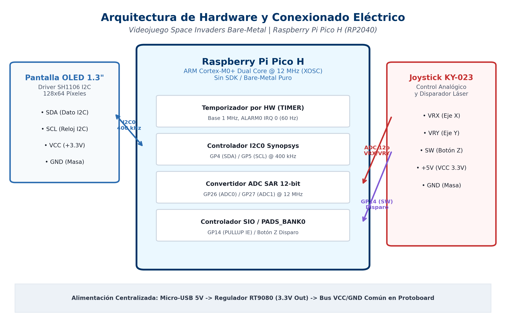
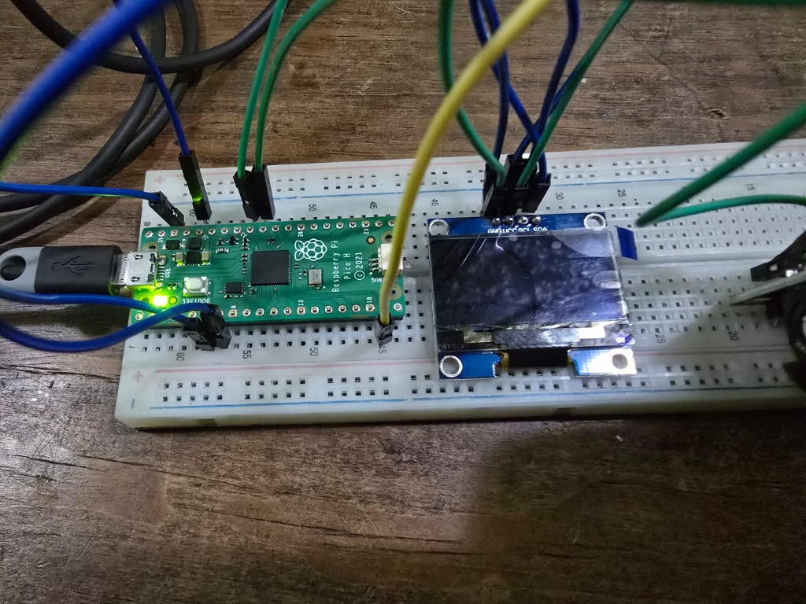
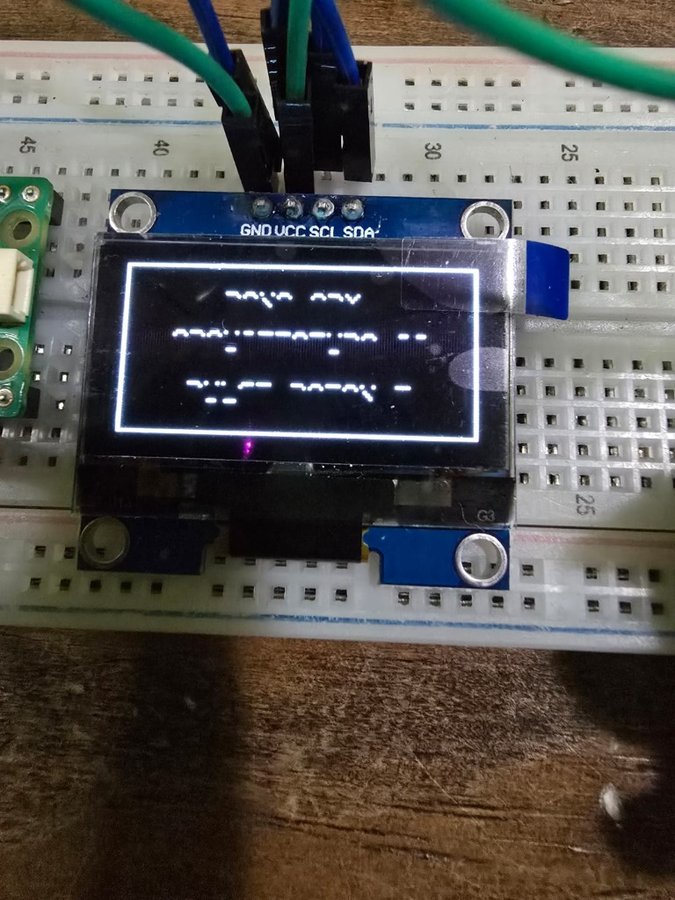
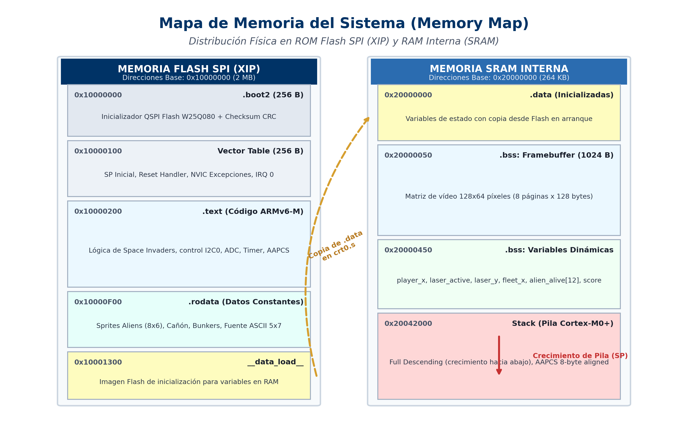
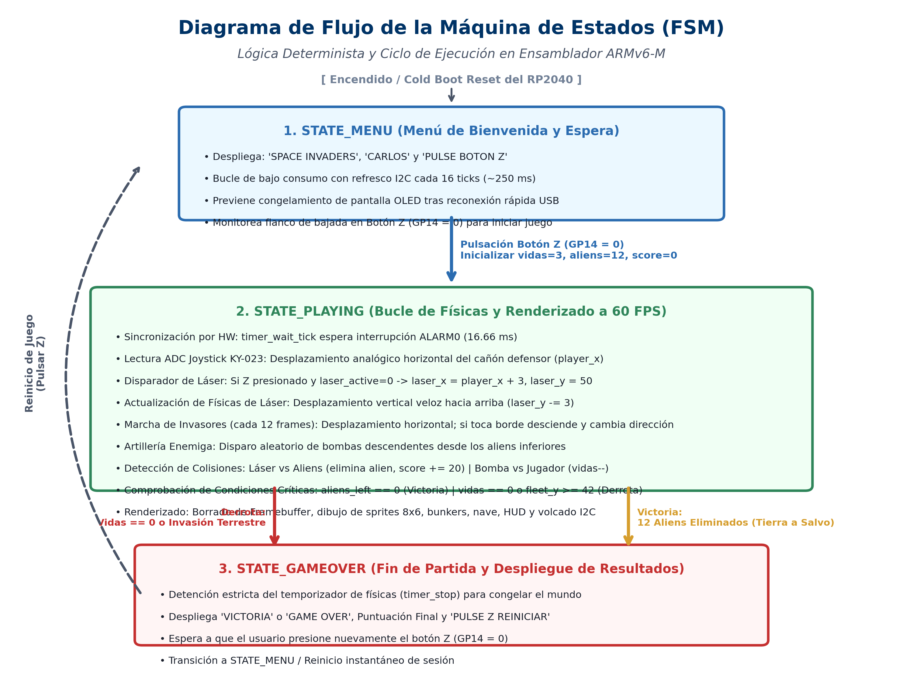
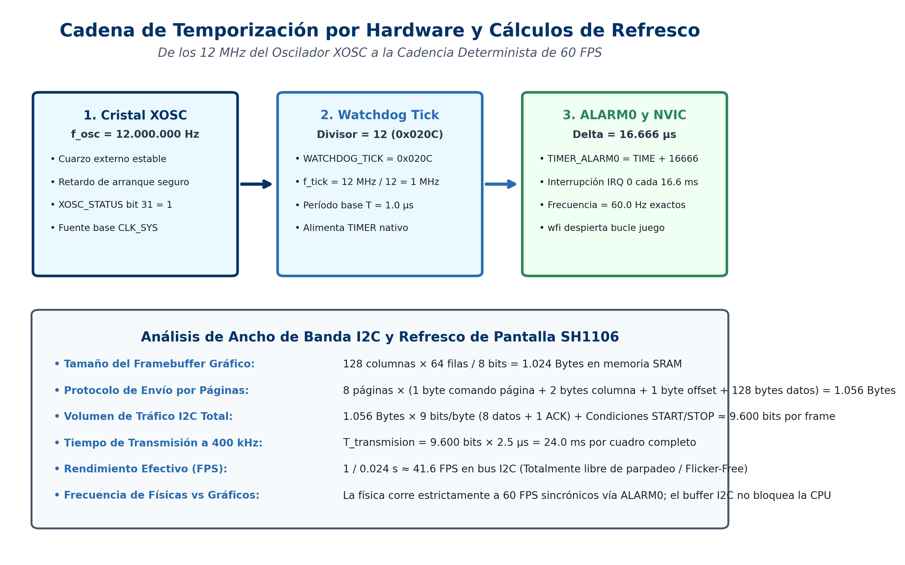
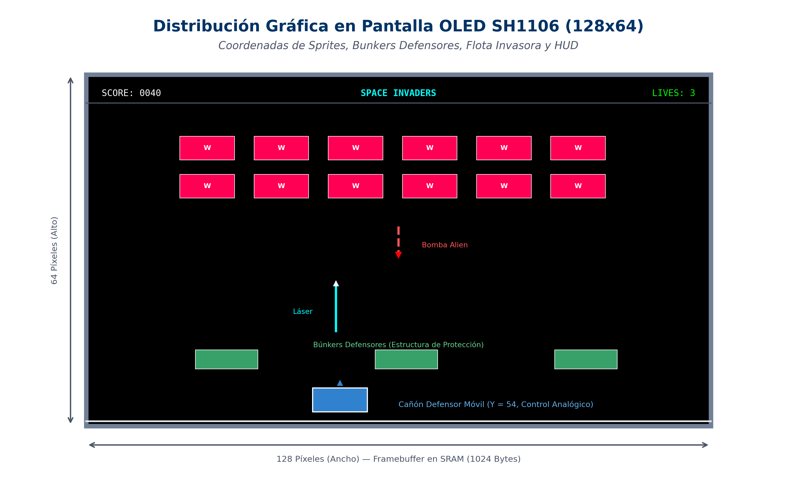

# Videojuego Space Invaders en Ensamblador ARMv6-M Bare-Metal
### Proyecto Único Individual | Arquitectura de Computadoras II

[-red.svg)](https://www.raspberrypi.com/documentation/microcontrollers/rp2040.html)
[-blue.svg)](https://developer.arm.com/documentation/ddi0419/c/)
[-success.svg)]()
[-orange.svg)]()
[-purple.svg)]()

---

## 👤 Información del Estudiante y Curso

* **Universidad:** Universidad Mariano Gálvez de Guatemala
* **Centro Regional:** Boca del Monte
* **Facultad:** Ingeniería en Sistemas de Información y Ciencias de la Computación
* **Curso:** Arquitectura de Computadoras II — Sección “B”
* **Estudiante:** **Carlos Fernando Cachin Montealegre**
* **Carné:** **7690-23-17107**
* **Fecha:** Noviembre de 2026

---

## 🚀 Descripción del Proyecto

Implementación completa y desde cero del legendario videojuego arcade **Space Invaders** en lenguaje ensamblador puro **ARMv6-M** para el microcontrolador **RP2040** (Raspberry Pi Pico H). 

El sistema opera bajo el paradigma **Bare-Metal Estricto**:
* **Sin Sistema Operativo ni RTOS:** Ejecución directa en el silicio sin capas intermedias.
* **Sin Raspberry Pi Pico SDK ni Bibliotecas en C:** No se utiliza ninguna biblioteca externa (`pico_stdlib`, `hardware_i2c`, etc.).
* **Acceso Directo a Registros de Silicio:** Cada periférico físico (relojes, I2C Synopsys, convertidor ADC SAR de 12 bits, temporizador por hardware ALARM0, controlador SIO y matriz de almohadillas PADS) es manipulado mediante punteros y desplazamientos hexadecimales oficiales.
* **Control Gráfico Flicker-Free:** Doble búfer con un **Framebuffer de 1024 bytes en SRAM** volcado por páginas a una pantalla OLED SH1106 de 1.3" a 400 kHz.

---

## 🔌 Esquema Electrónico y Conexiones de Hardware

| Periférico / Módulo | Pin del Módulo | Pin Pico H | Función en RP2040 | Descripción Técnica |
| :--- | :--- | :--- | :--- | :--- |
| **OLED SH1106 1.3"** | **SDA** | **GP4** (Pin 6) | `I2C0 SDA` (Función 3) | Línea de datos serie I2C bidireccional a 400 kHz |
| **OLED SH1106 1.3"** | **SCL** | **GP5** (Pin 7) | `I2C0 SCL` (Función 3) | Línea de reloj síncrono maestro |
| **OLED SH1106 1.3"** | **VCC** | **3V3(OUT)** (Pin 36) | Alimentación | 3.3V DC regulados por la Pico H |
| **OLED SH1106 1.3"** | **GND** | **GND** (Pin 38) | Masa Común | Plano de referencia 0V |
| **Joystick KY-023** | **VRX** | **GP26** (Pin 31) | `ADC Channel 0` | Muestreo analógico del cañón defensor (Eje X) |
| **Joystick KY-023** | **VRY** | **GP27** (Pin 32) | `ADC Channel 1` | Canal analógico complementario con auto-detección |
| **Joystick KY-023** | **SW (Botón Z)** | **GP14** (Pin 19) | `SIO GPIO14` (Función 5) | Entrada digital con pull-up interna (Disparo láser / Inicio) |
| **Joystick KY-023** | **+5V / VCC** | **3V3(OUT)** (Pin 36) | Alimentación | Tensión de referencia para divisores resistivos |
| **Joystick KY-023** | **GND** | **GND** (Pin 38) | Masa Común | Plano de referencia 0V |

### Diagrama de Arquitectura de Hardware


### Evidencia del Montaje Físico en Protoboard
| Montaje General de Hardware (Pico H + OLED + Cableado) | Despliegue Gráfico en Pantalla OLED SH1106 |
| :---: | :---: |
|  |  |

---

## 🏛️ Organización Modular del Código Fuente

El código fuente se encuentra rigurosamente estructurado en módulos especializados en lenguaje ensamblador (`.s`), garantizando claridad didáctica y facilidad de mantenimiento:

| Archivo | Responsabilidad / Descripción del Módulo |
| :--- | :--- |
| [`boot2.s`](boot2.s) | **Cargador de 2ª Etapa (256 bytes):** Configura la interfaz externa QSPI Winbond en modo Quad-Read continuo a 133 MHz y calcula el checksum CRC32. |
| [`crt0.s`](crt0.s) | **Arranque del Sistema:** Define la tabla de vectores NVIC del Cortex-M0+, inicializa el puntero de pila (`SP = 0x20042000`), copia `.data` desde Flash a SRAM y limpia la sección `.bss`. |
| [`system.s`](system.s) | **Relojes y Silicio:** Activa el cristal oscilador XOSC a 12 MHz, configura `CLK_REF`, `CLK_SYS`, `CLK_PERI`, `CLK_ADC`, programa el generador de microsegundos `WATCHDOG_TICK` (1 MHz) y libera periféricos de reset. |
| [`timer.s`](timer.s) | **Temporización e Interrupciones:** Gestiona el temporizador de 64 bits (`ALARM0`), la rutina `TIMER_IRQ_0_Handler` a 60 FPS y la función `timer_wait_tick` para reposo por hardware (`wfi`). |
| [`inputs.s`](inputs.s) | **Controlador de Entradas:** Configura `PADS_BANK0` e `IO_BANK0`. Lee el canal analógico ADC0 (VRX) a 12 MHz y el botón digital Z (GP14) con resistencia pull-up interna activa. |
| [`video.s`](video.s) | **Driver Gráfico y Framebuffer:** Inicializa el periférico Synopsys I2C0 a 400 kHz, envía la secuencia de encendido en doble fase del SH1106 y administra el Framebuffer de 1024 bytes en SRAM. |
| [`font.s`](font.s) | **Generador Tipográfico:** Tabla tipográfica ASCII de 5×7 píxeles y rutinas optimizadas para impresión de cadenas y números. |
| [`main.s`](main.s) | **Lógica del Videojuego:** Bucle principal a 60 FPS, cinemática de la flota invasora (12 aliens), proyectiles láser, bombas alienígenas, búnkers protectores, HUD y FSM. |
| [`memmap.ld`](memmap.ld) | **Linker Script:** Mapeo de memoria física del RP2040 (Flash XIP `0x10000000` y SRAM `0x20000000`). |
| [`build.bat`](build.bat) | **Script de Compilación Automatizado:** Ensambla, enlaza, genera binario raw y convierte a `.uf2`. |
| [`uf2conv.py`](uf2conv.py) | **Conversor UF2:** Convierte el binario crudo en bloques UF2 compatibles con el bootloader de la Pico. |

---

## 🛡️ Estándar AAPCS y Manejo Riguroso de la Pila (Stack)

En cumplimiento estricto de las directrices del curso y del estándar **Procedure Call Standard for the ARM Architecture (AAPCS)**:

1. **Uso de la Pila (Stack Full Descending):**
   * El puntero de pila (`SP`) se inicializa en `0x20042000` (`__stack_top`) y decrece hacia direcciones bajas de memoria.
   * **Alineación a 8 Bytes:** Se garantiza que el `SP` permanezca alineado a múltiplos de 8 bytes en cada límite de llamada externa, evitando fallos de hardware en el bus de datos Cortex-M0+.
2. **Preservación Simétrica de Registros:**
   * **Registros Preservados por el Llamado (Callee-Saved `r4-r7`, `lr`):** Toda subrutina que utilice estos registros realiza un guardado en el prólogo (`push {r4-r7, lr}`) y una restauración idéntica en el epílogo (`pop {r4-r7, pc}`).
   * **Registros de Argumentos y Retorno (`r0-r3`):** Se utilizan conforme a la convención AAPCS: parámetros en `r0`-`r3` y valor de retorno en `r0`.
   * **Llamadas Anidadas y Bucles Gráficos:** En bucles críticos donde se invocan funciones auxiliares (como `fb_draw_pixel`), el llamador apila temporalmente los registros volátiles (`push {r2, r3}`) antes del salto y los restaura (`pop {r2, r3}`) inmediatamente al retornar, protegiendo variables de iteración.
3. **Claridad en los Comentarios:** Cada módulo cuenta con encabezados de documentación formal, especificación de registros modificados, pre-condiciones, post-condiciones y explicación paso a paso de cada cálculo aritmético y lógico.

---

## 🗺️ Mapa de Memoria (Memory Map)



### Distribución en Flash SPI XIP (`0x10000000`) y SRAM (`0x20000000`)

```
========================= FLASH SPI XIP (Base: 0x10000000) =========================
0x10000000 - 0x100000FF : .boot2 (256 B) - Cargador continuo QSPI W25Q080 + CRC32
0x10000100 - 0x100001FF : .vectors (256 B) - Tabla de vectores NVIC Cortex-M0+
0x10000200 - 0x10000FFF : .text (~3.8 KB) - Instrucciones ARMv6-M puro
0x10001000 - 0x10001300 : .rodata (~1.2 KB) - Fuentes 5x7, sprites aliens y comandos
0x10001300              : __data_load__ - Imagen ROM para inicialización de .data

======================== MEMORIA SRAM INTERNA (Base: 0x20000000) ====================
0x20000000 - 0x2000003F : .data (~64 B) - Variables globales inicializadas
0x20000040 - 0x2000043F : Framebuffer Gráfico (1024 B) - 128x64 píxeles en memoria
0x20000440 - 0x20000490 : .bss (~80 B) - Variables dinámicas (físicas, puntaje, vidas)
...
0x20041000 - 0x20042000 : Stack (Pila del Sistema) - Crecimiento Full Descending
```

---

## 🔄 Máquina de Estados Finitos (FSM) y Lógica de Juego



La lógica del videojuego implementa una FSM determinista estructurada en 3 estados principales:

1. **`STATE_MENU` (Menú de Bienvenida y Recuperación Anti-Bloqueo):**
   * Despliega la pantalla de inicio con `"SPACE INVADERS"`, `"CARLOS"` y `"PULSE BOTON Z"`.
   * **Refresco Periódico I2C (Cold-Boot Recovery):** Cada 16 ciclos (~250 ms), retransmite la configuración al bus I2C. Esto previene de forma definitiva el congelamiento del panel OLED tras arranques en frío o desconexiones bruscas del cable USB.
   * Monitorea el flanco de bajada del Botón Z (GP14) para iniciar la partida.
2. **`STATE_PLAYING` (Bucle de Físicas a 60 FPS):**
   * **Cañón Defensor Móvil:** Muestreo analógico del joystick KY-023 para desplazamiento horizontal fluido sobre el eje inferior ($Y = 54$).
   * **Disparos del Defensor:** El botón Z dispara un láser veloz (3 píxeles/frame hacia arriba).
   * **Flota Invasora:** 12 aliens organizados en 2 filas de 6. Marchan horizontalmente y descienden 3 píxeles hacia la Tierra cada vez que tocan un lateral de la pantalla.
   * **Artillería Enemiga:** Bombas aleatorias lanzadas desde los invasores inferiores hacia la superficie.
   * **Búnkers Protectores:** Estructuras defensivas que absorben impactos.
   * **Colisiones y Reglas:** Láser vs Alien (suma 20 pts y elimina alien) | Bomba vs Cañón (pierde 1 de 3 vidas).
3. **`STATE_GAMEOVER` (Evaluación y Congelamiento):**
   * Se alcanza por Victoria (12 aliens destruidos) o Derrota (vidas agotas o invasores tocan tierra en $Y \ge 42$).
   * Invoca `timer_stop` para detener por completo el temporizador de físicas.
   * Muestra la puntuación final y espera una pulsación del Botón Z para reiniciar la sesión.

---

## ⏱️ Temporización por Hardware y Cálculos de Refresco



### 1. Base de Microsegundos (1 MHz)
El oscilador de cristal externo opera a $f_{	ext{XOSC}} = 12\,	ext{MHz}$. El registro divisor `WATCHDOG_TICK` (offset `0x2C`) se programa con `0x020C` (divisor de 12 ciclos):
$$f_{	ext{tick}} = rac{12,000,000\,	ext{Hz}}{12} = 1,000,000\,	ext{Hz} \implies T_{	ext{tick}} = 1.0\,\mu	ext{s}$$

### 2. Cadencia de 60 Cuadros por Segundo (60 FPS)
Para obtener 60 hercios deterministas en la física del juego:
$$T_{	ext{frame}} = rac{1.0\,	ext{s}}{60\,	ext{Hz}} = 16,666.ar{6}\,\mu	ext{s} pprox 16,666\,\mu	ext{s}$$
En cada interrupción, la rutina de servicio del timer programa el comparador de hardware:
$$	ext{TIMER\_ALARM0} = 	ext{TIMERAWL} + 16,666$$
El periférico genera la señal `TIMER_IRQ_0` (IRQ 0) en el NVIC, despertando al procesador mediante `wfi` y eliminando demoras vacías.

### 3. Ancho de Banda I2C y Refresco de Pantalla (400 kHz)
* **Datos por cuadro:** 8 páginas $	imes$ 132 bytes = 1,056 bytes $	imes$ 9 bits $pprox$ 9,504 bits.
* **Periodo I2C:** $T_{	ext{I2C}} = rac{1}{400\,	ext{kHz}} = 2.5\,\mu	ext{s}$.
* **Tiempo de transmisión por cuadro:** $T_{	ext{frame}} = 9,504 	imes 2.5\,\mu	ext{s} pprox 23.76\,	ext{ms}$.
* **Tasa de refresco efectiva:** $	ext{FPS}_{	ext{I2C}} pprox rac{1}{0.0238\,	ext{s}} pprox 42.0\,	ext{FPS}$ (*Flicker-Free*).

---

## 👾 Distribución Gráfica y Representación de Sprites



* **Resolución:** $128 	imes 64$ píxeles direccionados mediante 8 páginas verticales de 8 bits.
* **Offset SH1106:** Desplazamiento de 2 columnas para centrar la imagen en la memoria interna de 132 columnas.
* **Fórmula de Mapeo de Píxeles:**
  $$	ext{página} = Y \gg 3, \quad 	ext{desplazamiento} = (	ext{página} \ll 7) + X, \quad 	ext{máscara} = 1 \ll (Y \ \& \ 7)$$

---

## 🛠️ Guía de Compilación y Flasheo

### Requisitos Previos
* **Toolchain:** GNU Arm Embedded Toolchain (`arm-none-eabi-as`, `arm-none-eabi-ld`, `arm-none-eabi-objcopy`).
* **Python 3:** Para la ejecución del script conversor `uf2conv.py`.

### Compilación por Lotes
Abre una terminal de comandos en la raíz del repositorio y ejecuta:
```cmd
build.bat
```
El script compilará todos los módulos `.s`, enlazará los objetos contra `memmap.ld`, generará el binario crudo `space_invaders.bin` y creará `space_invaders.uf2`.

### Procedimiento para Cargar en la Raspberry Pi Pico H
1. Desconecta el cable micro-USB de la Raspberry Pi Pico H.
2. Mantén presionado el botón blanco **BOOTSEL** en la placa física.
3. Conecta el cable micro-USB a tu computadora y suelta el botón BOOTSEL.
4. La computadora reconocerá la placa como una unidad de almacenamiento USB llamada **`RPI-RP2`**.
5. Copia o arrastra el archivo precompilado **`space_invaders.uf2`** hacia la unidad `RPI-RP2`.
6. La unidad se desmontará automáticamente y Space Invaders arrancará inmediatamente en la pantalla OLED.

---

## 📄 Entregables Académicos Incluidos

* 📄 **Reporte Técnico Oficial en Word (.docx):** [`REPORTE_TECNICO_SPACE_INVADERS_ARM.docx`](REPORTE_TECNICO_SPACE_INVADERS_ARM.docx) *(2.30 MB, con portada formal de la Universidad Mariano Gálvez, esquemas, tablas de registros, cálculos y fotos).*
* 📄 **Reporte Técnico en Markdown (.md):** [`REPORTE_TECNICO.md`](REPORTE_TECNICO.md)
* 🎮 **Binario Compilado Listo para Jugar (.uf2):** [`space_invaders.uf2`](space_invaders.uf2)

---
*Desarrollado por Carlos Fernando Cachin Montealegre (7690-23-17107) para Arquitectura de Computadoras II.*
